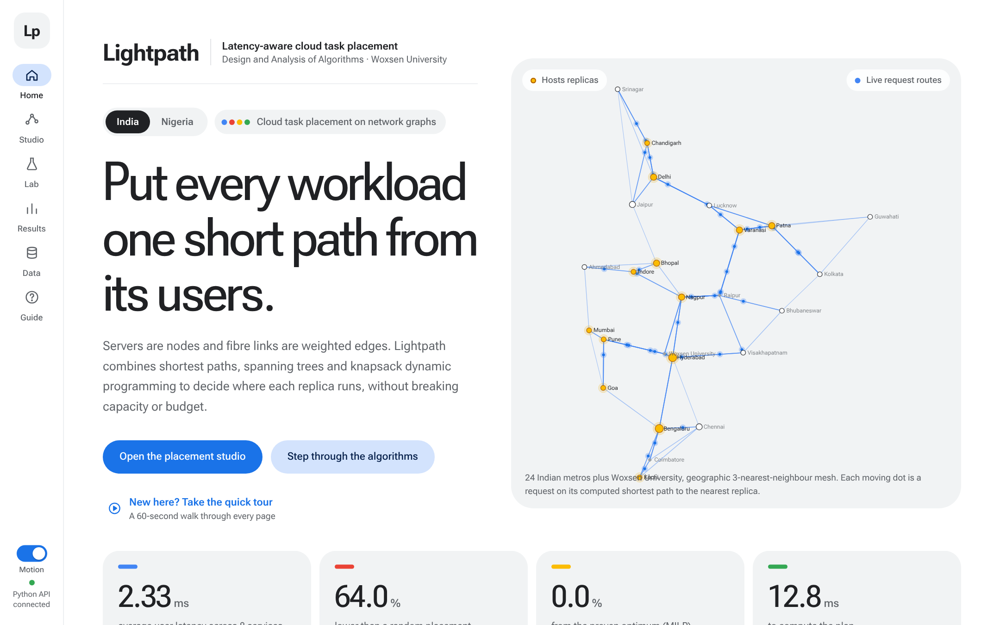

# Lightpath: latency-aware cloud task placement

Servers are graph nodes and link latencies are edge weights. Lightpath places service replicas / VMs to
**minimise demand-weighted average latency** while respecting **CPU and memory capacity** and a **budget**,
then explains the plan as routes, server schedules, cost/benefit tables and plain-language recommendations.

*Built by **Naman Singla** and **Mohak Gupta**, guided by **Dr. Monday Jubrin Abdullahi**. Woxsen University.*



## Deliverables

| | |
|---|---|
| **Report** (cover + 25 pages, IEEE references) | [`report/Lightpath_Report.pdf`](report/Lightpath_Report.pdf) |
| **Presentation** (10 slides) | [`presentation/Lightpath_Presentation.pdf`](presentation/Lightpath_Presentation.pdf) |
| **Website** | `./run.sh`, then http://localhost:8000 |
| **Demo notebook** | [`notebooks/lightpath_demo.ipynb`](notebooks/lightpath_demo.ipynb) |

## Run it

```bash
./run.sh          # macOS / Linux   (Windows: run.bat)
```

It creates a Python environment, installs dependencies, builds the website (if Node.js is installed;
otherwise it uses the prebuilt `web/dist`) and opens **http://localhost:8000**. One process serves both the
website and the API.

Without Python the website still works: open `web/dist` on any static host and it shows saved results
(controls that need the engine are switched off and say so).

| Task | Command |
|---|---|
| Tests (191, checked against NetworkX and brute force) | `python -m pytest -q` |
| Regenerate datasets, Gephi files and policy CSVs | `python scripts/build_datasets.py` |
| Run all experiments (~80 s) → CSVs + report figures | `python experiments/run_experiments.py` |
| Refresh the website's saved results | `python scripts/export_demo.py` |
| Website in development mode (hot reload) | `uvicorn api.server:app --port 8000` and `cd web && npm run dev` |
| Notebook walkthrough | `jupyter notebook notebooks/lightpath_demo.ipynb` |

## The website

| Page | What it does |
|---|---|
| **Landing** | Project title with a colour-wave / text-pressure effect and the team. |
| **Home** | Quick-tour button, India / Nigeria switch, live map with requests travelling their shortest paths, headline numbers, the 7-stage pipeline, all networks. |
| **Placement studio** | Pick a network, VM budget, server budget, sizing and strategies, then solve live. Map layers (MST, replicas, routes), service filter, and tabs for routes, server load, cost/benefit, replica sync and batch schedule. |
| **Algorithm lab** | Pick a start city and a destination and watch Prim, Kruskal, Dijkstra or Bellman-Ford step by step (0.5×–4×) with highlighted pseudocode; the final route is drawn and listed hop by hop. Floyd–Warshall and Johnson show distance heatmaps. *Compare two algorithms* runs two on the same trip and says which suits it. |
| **Results** | Interactive charts for the 8 experiments with takeaways, CSV and report-figure downloads. |
| **Data** | Every network with JSON, Gephi (GEXF) and CSV downloads, plus a generator for new networks. |
| **Guide** | How to use each page, a glossary, a 1-minute guided tour and `?` help on every panel. |

Design: Material 3 layout with the Google palette, Roboto Flex. Effects (splash fluid cursor, scroll
velocity, text cursor, glitch, split text, count-up) can be switched off with the **Motion** toggle and respect
the system reduced-motion setting.

## Algorithms

| Stage | Algorithm | Complexity |
|---|---|---|
| Latency matrix | Floyd–Warshall (dense) · Johnson / repeated Dijkstra (sparse), chosen automatically | Θ(V³) · O(VE log V) |
| Backbone | MST: Prim (binary / Fibonacci / pairing heap) · Kruskal (union-find) | O(E log V) · O(E log E) |
| Routing | Dijkstra (non-negative) · Bellman-Ford (negative transfer costs) | O(E log V) · O(VE) |
| Server activation | 0/1 knapsack DP | Θ(nW) |
| Replica sizing | Multiple-choice knapsack DP, then first-fit-decreasing capacity repair | Θ(W·Σoptions) |
| Placement | Greedy: demand-first, CELF marginal-gain, regret, FFD packing | see report |
| Refinement | Relocate + swap local search | per pass O(Σk·S·C) |
| Optimality check | Exact MILP (HiGHS) + LP lower bound | exponential worst case |
| Batch schedule | Network-aware LPT / earliest-finish-time list scheduling | O(T·S log L) |

Negative edges: transfer cost is `c(u→v) = base + per_ms·latency + φ(u) − φ(v)`, where φ is a site price level.
Some arcs become negative (rebates), but φ cancels around every cycle, so there is never a negative cycle; this is
why Bellman-Ford and Johnson are needed and why they always succeed.

## Repository layout

```
cloudplace/
  core/        graph (adjacency lists), heaps (binary, Fibonacci, pairing, lazy), union-find
  algorithms/  mst, sssp, apsp, knapsack, placement (greedy + local search), exact (MILP), scheduler
  model/       problem formulation (instance.py), transfer-cost graph (costs.py)
  data/        generators (Waxman, Erdős–Rényi, Barabási–Albert, fat-tree, Abilene, NSFNET, India, Nigeria, Woxsen), GEXF export
  solver.py    end-to-end pipeline and policy outputs
api/           FastAPI service; also serves the built website
web/           React + TypeScript dashboard (src/), prebuilt site (dist/)
datasets/      10 instances (*.json), Gephi files (gexf/), policy tables (policies/*.csv)
experiments/   run_experiments.py, results/*.csv, figures/*.png
notebooks/     lightpath_demo.ipynb (executed, with outputs)
scripts/       build_datasets.py, export_demo.py, make_notebook.py
tests/         pytest suite
design/        approved design previews
```

## Datasets

| Name | Source | Sites / links |
|---|---|---|
| india | 24 Indian metros + Woxsen University, real coordinates, geographic 3-NN mesh | 25 / 44 |
| nigeria | 24 Nigerian cities, real coordinates, geographic 3-NN mesh; Lagos, Abuja, Port Harcourt as core | 24 / 47 |
| woxsen | Woxsen University campus, sites from the official campus map | 23 / 29 |
| abilene | Internet2 Abilene backbone (real topology) | 11 / 14 |
| nsfnet | NSFNET T1 backbone (real topology) | 14 / 21 |
| fat-tree-k4 | k=4 data-centre fat-tree | 36 / 48 |
| waxman-60, waxman-60-tight | Waxman geographic WAN (nominal and 0.5× capacity) | 60 / 89 |
| er-100 | Erdős–Rényi | 100 / 350 |
| ba-150 | Barabási–Albert scale-free | 150 / 296 |

Latency model: 1.3 × great-circle km / 200 km·ms⁻¹ + 0.3 ms switching (sub-millisecond on the campus).
Links for India and Nigeria are synthesised geographically on real city locations, not taken from a carrier map.

## Headline results

* Greedy + local search is within **≈0.5 % of the proven MILP optimum on average** (max ≈3 %) for n ≤ 160,
  at roughly 5× lower runtime (greedy alone is 10–100× cheaper); at n = 240 the comparison is against the LP lower bound.
* Under tight capacity the latency-first greedies often fail to place every replica, while **FFD packing +
  local search stays feasible**: feasibility and latency pull in different directions.
* Fibonacci heaps have the better bound but are **slower in CPython** than binary heaps; `heapq` with lazy
  deletion is fastest in practice.
* The automatic all-pairs rule picks repeated Dijkstra on sparse graphs and vectorised Floyd–Warshall on dense ones.
